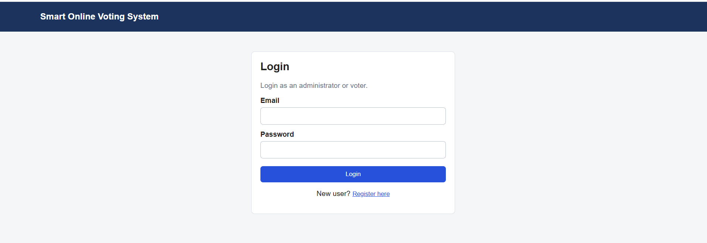
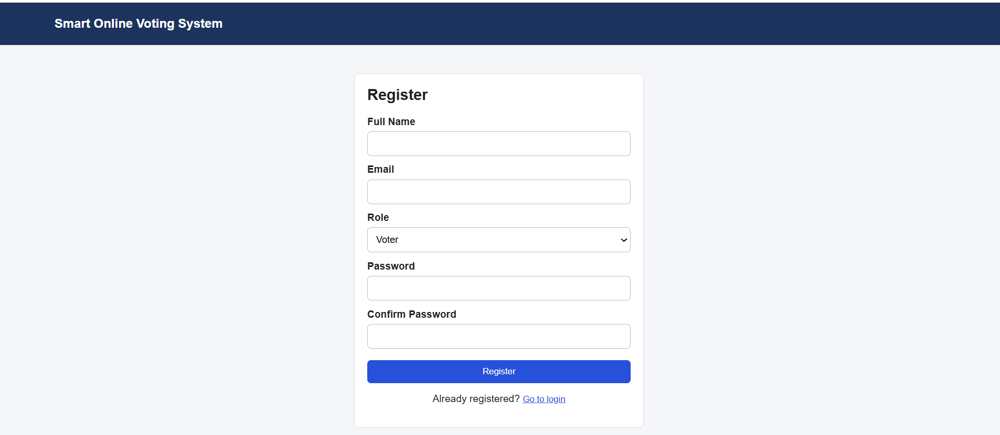
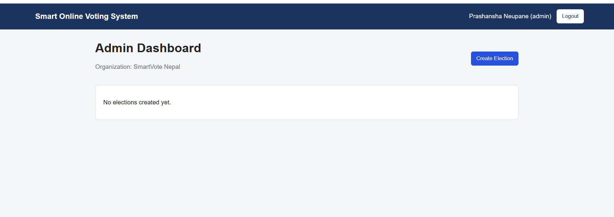
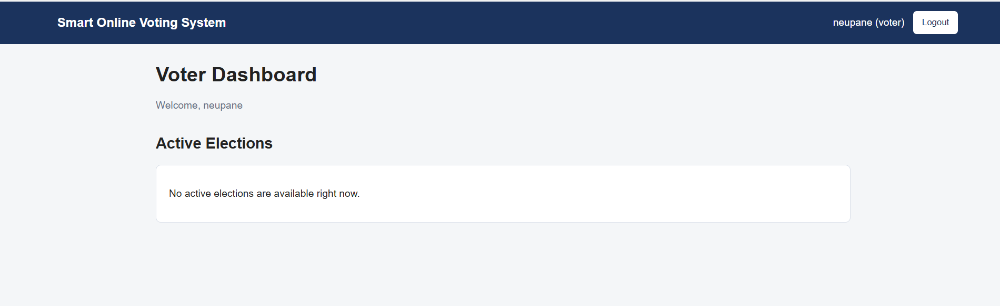

# Smart Online Voting System

A simple, user-friendly online voting system built with the MERN stack for a BCA 4th semester college project. Administrators create and manage organization elections, while registered voters access active ballots using an election code and submit their selections through a React interface.

## Project objectives

- Provide a web interface for organizing and participating in small elections.
- Apply MongoDB, Express.js, React, and Node.js in a complete application.
- Separate administrator and voter actions through authenticated API routes.
- Validate election schedules and ballot selections on the server.
- Record participation separately from candidate selections and prevent duplicate participation.
- Present candidate vote counts and election turnout to the election creator.

## Technologies used

| Layer | Technologies |
| --- | --- |
| Frontend | React 18, Vite 5, JavaScript, HTML, CSS, browser Fetch API |
| Backend | Node.js, Express 4 |
| Database | MongoDB, Mongoose 8 |
| Authentication | JSON Web Tokens, bcryptjs password hashing |
| Development | npm, nodemon, concurrently |

Exact dependency versions are recorded in the root, backend, and frontend `package-lock.json` files.

## Main features

- **Accounts:** administrator and voter registration, login, logout, and password hashing. Administrators supply an organization name during registration.
- **Authenticated access:** JWT authentication with administrator and voter middleware; login tokens expire after one day.
- **Election management:** create elections with a title, description, start and end times, multiple positions, and at least two candidates per position. The creator can edit or delete an election before it starts.
- **Election access:** each election receives a generated six-character access code. Voters see active elections and must supply the correct code to open a ballot and submit a vote.
- **Ballot validation:** voters select one valid candidate for every position; the backend checks the code, election timing, positions, and candidates.
- **Duplicate participation prevention:** a unique MongoDB index on the election and voter IDs prevents a second participation record for the same election.
- **Separate ballot storage:** participation records store the voter ID; ballot documents store selections without a voter ID. This describes the data model rather than a guarantee of complete anonymity.
- **Administrator results:** the election creator can view turnout and candidate vote counts for each position, including while an election is active.
- **Responsive interface:** layouts adapt to smaller screens through CSS media queries.

## Project structure

```text
Smart-Online-Voting-System/
|-- backend/
|   |-- config/
|   |   `-- db.js
|   |-- middleware/
|   |   `-- auth.js
|   |-- models/
|   |   |-- Ballot.js
|   |   |-- Election.js
|   |   |-- Participation.js
|   |   `-- User.js
|   |-- routes/
|   |   |-- authRoutes.js
|   |   |-- electionRoutes.js
|   |   `-- voteRoutes.js
|   |-- .env.example
|   |-- package.json
|   |-- package-lock.json
|   `-- server.js
|-- frontend/
|   |-- src/
|   |   |-- components/
|   |   |   |-- AdminDashboard.jsx
|   |   |   |-- ElectionForm.jsx
|   |   |   |-- Login.jsx
|   |   |   |-- Navbar.jsx
|   |   |   |-- Register.jsx
|   |   |   |-- Results.jsx
|   |   |   `-- VoterDashboard.jsx
|   |   |-- api.js
|   |   |-- App.jsx
|   |   |-- main.jsx
|   |   `-- styles.css
|   |-- index.html
|   |-- package.json
|   |-- package-lock.json
|   `-- vite.config.js
|-- .gitignore
|-- package.json
|-- package-lock.json
`-- README.md
```

The Express route files contain the request-handler logic; the current project has no separate controllers directory. Local `.env` files and installed dependencies are excluded from Git.

## Installation

### Prerequisites

- Node.js 22 or newer and npm. The root `concurrently` dependency requires Node.js 22 or newer.
- A running MongoDB instance, either locally installed MongoDB Community Server or a MongoDB Atlas deployment accessible to your machine.
- Git to clone the repository.

### Clone and install dependencies

```bash
git clone https://github.com/prashansha005/Smart-online-voting-system.git
cd Smart-online-voting-system
npm ci
npm ci --prefix backend
npm ci --prefix frontend
```

These commands install the versions recorded in each lockfile. The root also provides `npm run install:all`, which runs `npm install` in the backend and frontend; install root dependencies separately with `npm ci` first.

## Environment variable setup

For a fresh clone, create a private backend configuration file from the example.

On Windows PowerShell:

```powershell
Copy-Item backend/.env.example backend/.env
```

On macOS or Linux:

```bash
cp backend/.env.example backend/.env
```

If you already have `backend/.env`, keep it and review the required variables instead of copying over it.

The example contains placeholders only:

```dotenv
PORT=5000
MONGO_URI=<your-mongodb-connection-string>
JWT_SECRET=<your-unique-random-secret>
```

| Variable | Purpose |
| --- | --- |
| `PORT` | Backend HTTP port; use `5000` with the current frontend configuration. |
| `MONGO_URI` | Your private MongoDB connection URI, including the database name. For local development, use your local MongoDB host and port, and a project database such as `smart_online_voting`. |
| `JWT_SECRET` | A unique, randomly generated value used to sign and verify login tokens. |

Generate a new secret locally with:

```bash
node -e "console.log(require('node:crypto').randomBytes(32).toString('hex'))"
```

Paste the generated value into your private `backend/.env`, replacing the placeholder. Fill in your own MongoDB URI there as well. Never commit generated secrets, database connection strings, or real account details. The frontend does not currently require an environment file.

## Running the project

Start MongoDB or confirm that your remote database is reachable before starting the backend. If MongoDB was installed as a Windows service, make sure that service is running.

From the project root, start both development servers:

```bash
npm run dev
```

Alternatively, use two terminals from the project root.

Backend:

```bash
npm run dev --prefix backend
```

Frontend:

```bash
npm run dev --prefix frontend
```

| Service | Local address |
| --- | --- |
| Frontend | http://localhost:5173 |
| Backend health response | http://localhost:5000/ |
| API base | http://localhost:5000/api |

The backend waits for MongoDB to connect before listening. The frontend API address is configured in `frontend/src/api.js`, and the backend allows the frontend origin `http://localhost:5173` in `backend/server.js`. Keep these addresses aligned if you change ports or deploy the application.

To start the backend without nodemon:

```bash
npm start --prefix backend
```

## Build and verification

Build the frontend:

```bash
npm run build --prefix frontend
```

Preview that build locally:

```bash
npm run preview --prefix frontend -- --port 5173
```

The backend must still be running for API requests. Build output is written to `frontend/dist/` and is excluded from Git. The backend runs directly with Node.js and has no build script. No automated test or lint scripts are currently defined in the package manifests.

### Manual demonstration

1. Open the frontend, register an administrator with an organization name, and log in.
2. Create an election with at least one position and two candidates. For an immediate demonstration, choose a start time in the recent past and an end time in the future.
3. Note the generated election access code, then log out.
4. Register and log in as a voter, open the active election using the code, and select one candidate for each position.
5. Submit and confirm the ballot. Verify that the election now shows that the voter has already voted.
6. Log back in as the election creator and open **Results** to view turnout and candidate counts.
7. Create a separate future election to demonstrate editing and deletion before its start time.

Use synthetic demonstration accounts and candidate details when creating public screenshots.

## API overview

| Method | Endpoint | Access and purpose |
| --- | --- | --- |
| `GET` | `/` | API health response |
| `POST` | `/api/auth/register` | Register an administrator or voter |
| `POST` | `/api/auth/login` | Log in and receive a JWT |
| `GET` | `/api/auth/me` | Authenticated user details |
| `POST` | `/api/elections` | Administrator: create an election |
| `GET` | `/api/elections/admin` | Administrator: list own elections |
| `GET` | `/api/elections/active` | Voter: list active elections |
| `POST` | `/api/elections/:id/access` | Voter: validate an election access code |
| `GET` | `/api/elections/:id` | Creator: retrieve an election |
| `PUT` | `/api/elections/:id` | Creator: edit an election before it starts |
| `DELETE` | `/api/elections/:id` | Creator: delete an election before it starts |
| `GET` | `/api/elections/:id/results/view` | Creator: view turnout and vote counts |
| `POST` | `/api/votes/:electionId` | Voter: submit a complete ballot |

Protected endpoints use the `Authorization: Bearer <token>` header.

## Screenshots

### Login



### Registration



### Administrator Dashboard



### Voter Dashboard



## Troubleshooting

- **MongoDB connection fails:** confirm MongoDB is running or reachable and check `MONGO_URI` in your private `backend/.env`.
- **Frontend loads but API requests fail:** confirm the backend is listening on port `5000` and that database startup succeeded.
- **Port 5173 is occupied:** stop the conflicting server or update the frontend address and backend CORS configuration together. Vite may otherwise choose a different port.
- **PowerShell blocks `npm.ps1`:** use `npm.cmd` in place of `npm`, for example `npm.cmd run dev`.
